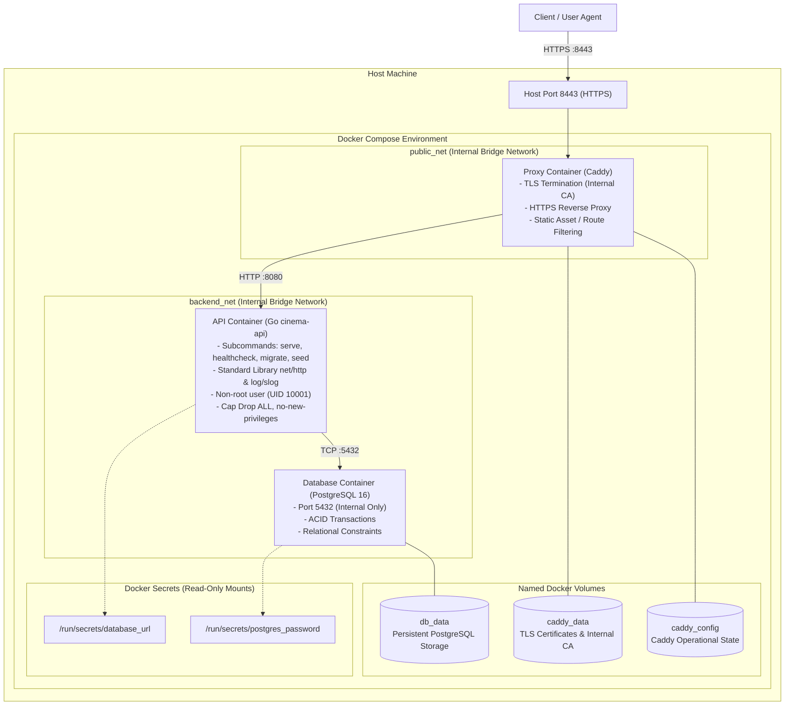
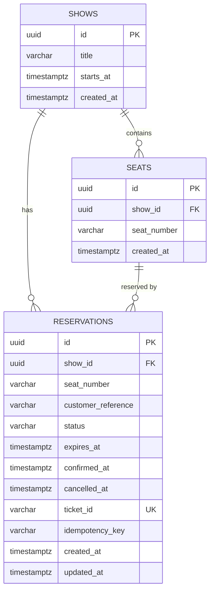
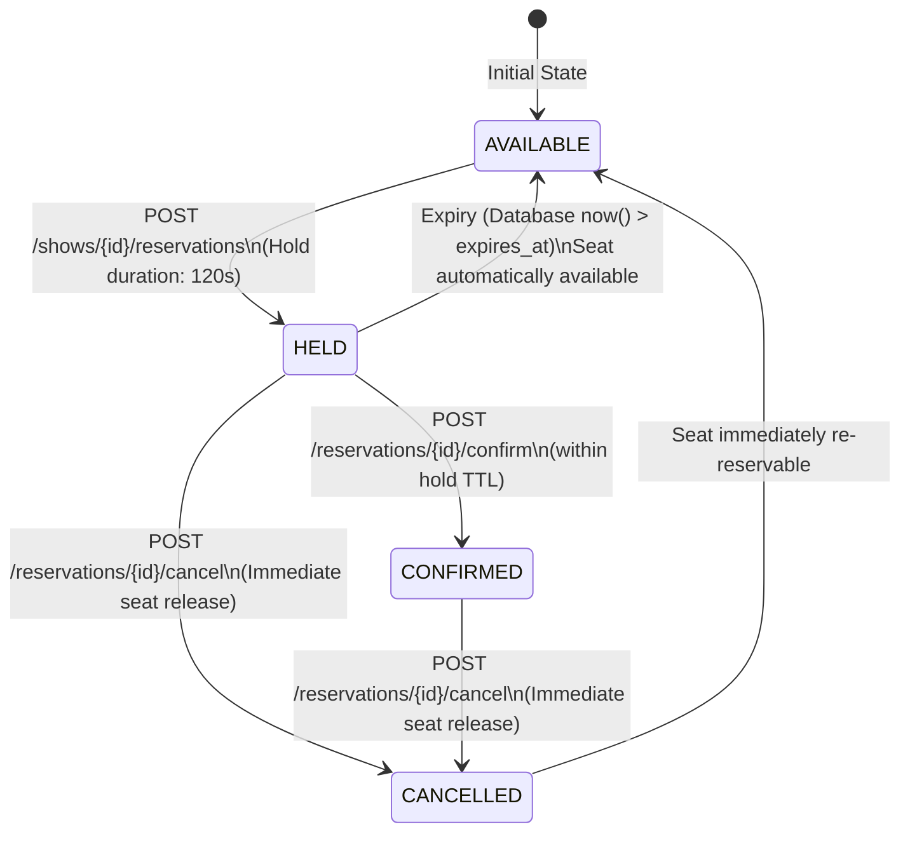
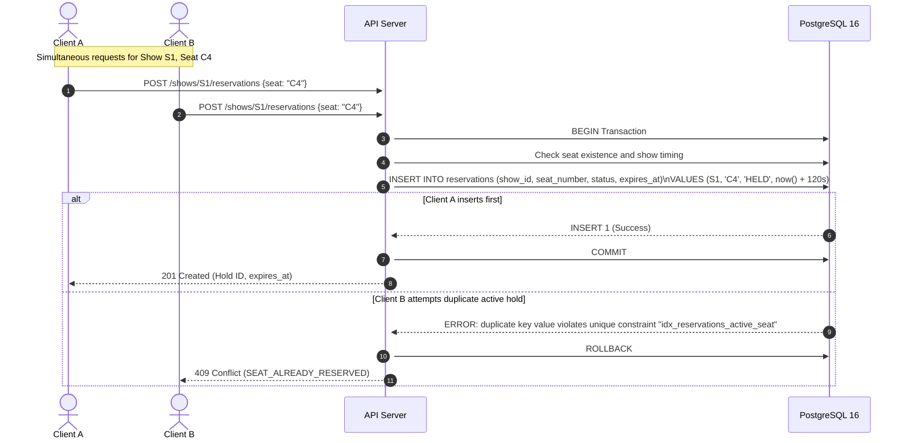

# Architecture and Design

This document describes the software architecture, data modeling, concurrency control, and security design of the cinema reservation system.

---

## 1. System Topology and Container Architecture

The system is deployed as three decoupled container services managed by Docker Compose across isolated internal networks. Only the reverse proxy exposes a network port to the host system.

### Network Isolation Rules
- **No published database port:** PostgreSQL listens on port 5432 exclusively inside `backend_net`. Neither the host machine nor the `public_net` reverse proxy can access the database directly.
- **Single ingress point:** Caddy is the only service that publishes a host port (`8443` mapping to container port `443`). Direct HTTP access to the Go API container is restricted to `public_net`.
- **Inter-service routing:** Containers communicate using Docker internal DNS hostnames (`api` and `db`).

---

## 2. CI/CD and Delivery Pipeline Flow

Every commit and pull request passes through an automated validation and build pipeline before any container image can be published or deployed.

---

## 3. Data Model and Relational Schema

The PostgreSQL schema enforces data integrity through foreign keys, check constraints, and partial indexes.

### Relational Constraints
- `idx_reservations_active_seat`: Partial unique index on `(show_id, seat_number)` where `status IN ('HELD', 'CONFIRMED')`. Prevents concurrent holds or confirmations on the same seat.
- `reservations_status_check`: Check constraint enforcing `status IN ('HELD', 'CONFIRMED', 'CANCELLED', 'EXPIRED')`.
- `reservations_ticket_required`: Check constraint ensuring that whenever `status = 'CONFIRMED'`, `ticket_id IS NOT NULL` and `confirmed_at IS NOT NULL`.
- `idx_reservations_ticket_id`: Unique index ensuring global uniqueness of ticket identifiers.

---

## 4. Concurrency Control and Hold Lifecycle

The reservation lifecycle consists of three distinct states: `HELD`, `CONFIRMED`, and `CANCELLED` (or `EXPIRED`).

### Concurrent Hold Request Resolution

When multiple clients attempt to reserve the same seat simultaneously, PostgreSQL transaction isolation and the partial unique index guarantee that exactly one transaction succeeds.

### Guarantees Enforced at Database Level
1. **Clock Source Independence:** Hold expiration is evaluated using `now()` on the PostgreSQL database server. Application server clock drift has zero effect on reservation validity.
2. **Zero Dependency on Background Workers:** An expired hold (`now() > expires_at`) is recognized as expired immediately during read and write queries. The database does not require a background sweeper to maintain consistency.
3. **Cryptographic Ticket Uniqueness:** Confirmed reservations generate a 64-bit random ticket string formatted as `TKT-<16 hex chars>` derived from `crypto/rand`. In the event of a theoretical collision, a unique constraint violation triggers a retry.
4. **Idempotency:**
   - Repeating a hold request with an identical `Idempotency-Key` returns the original reservation record.
   - Confirming an already confirmed reservation returns the existing ticket identifier with HTTP 200.
   - Cancelling an already cancelled reservation returns HTTP 200 without side effects.

---

## 5. Security Architecture and Hardening

The application runtime is hardened across container, operating system, and network boundaries:

1. **Non-Root Execution:** The application container runs under UID `10001` (`appuser`). The container never acquires root privileges.
2. **Capability Dropping:** Docker Compose specifies `cap_drop: [ALL]` and `security_opt: [no-new-privileges:true]` on all application containers.
3. **Secret Files:** Sensitive credentials are supplied via Docker secrets or bind-mounted files (`DATABASE_URL_FILE`), read directly from disk into application memory without appearing in environment variables or container inspection output.
4. **Minimal Runtime Image:** The production image contains only the compiled Go binary, CA certificates, and standard non-privileged user definitions. Shells, package managers, and development utilities are excluded.
5. **TLS Encryption:** Inbound client connections are terminated over HTTPS using Caddy. Traffic between Caddy and the Go API runs over an internal Docker bridge network.

---

## 6. Key Decisions and Trade-Offs

| Decision | Alternative Considered | Rationale and Trade-off |
|---|---|---|
| Go standard library `net/http` | Gin, Echo, Fiber | Eliminates third-party router vulnerabilities; standard library method routing (`GET /v1/shows/{id}`) provides readable, zero-dependency routing. |
| PostgreSQL Partial Unique Index | Redis Distributed Locks | Eliminates cache-database split-brain risk. ACID transactions and indexes guarantee absolute consistency without an extra data store. |
| Database Clock (`now()`) | Application System Clock | Application servers may experience clock skew. The database clock provides a single monotonic source of truth for hold expiration. |
| Additive Migrations Only | Up/Down Rollback Migrations | Down-migrations risk accidental data loss during production rollbacks. Additive migrations allow code rollbacks without schema rollbacks. |
| Caddy Reverse Proxy | Nginx / Envoy | Built-in automatic TLS certificate management, simpler declarative configuration, and native health checking. |
