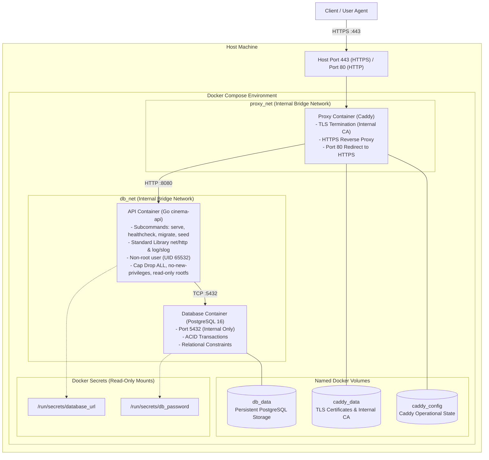
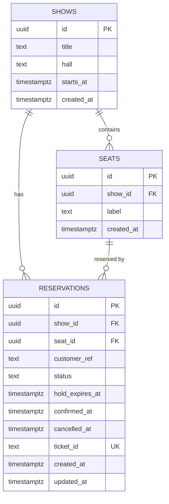
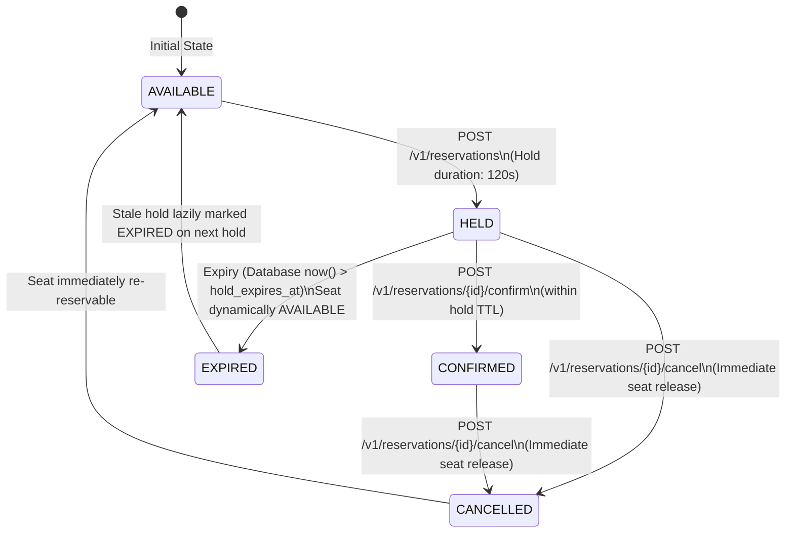
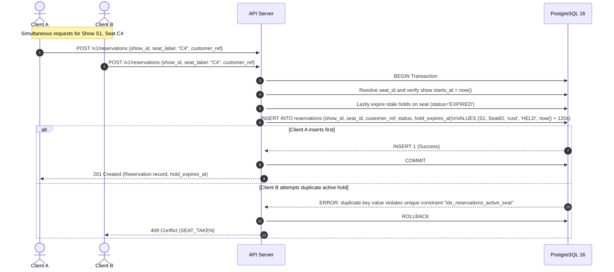

# Architecture and Design

This document describes the software architecture, data modeling, concurrency control, and security design of the cinema reservation system.

---

## 1. System Topology and Container Architecture

The system is deployed as three decoupled container services managed by Docker Compose across isolated internal bridge networks. Only the reverse proxy exposes network ports to the host system.

### Network Isolation Rules
- **No published database port:** PostgreSQL listens on port 5432 exclusively inside `db_net`. Neither the host machine nor the reverse proxy can access the database directly.
- **Single ingress point:** Caddy is the only service that publishes host ports (`443` for HTTPS, `80` for redirect). Direct HTTP access to the Go API container is restricted to `proxy_net`.
- **Inter-service routing:** Containers communicate using Docker internal DNS hostnames (`api` and `db`).

---

## 2. CI/CD and Delivery Pipeline Flow

Every commit and pull request passes through an automated validation and build pipeline before any container image can be published or deployed.

```mermaid
flowchart LR
    DevCommit["Git Commit / PR"] --> CIJob["GitHub Actions CI Pipeline"]

    subgraph CIQualityGates["Quality and Security Gates"]
        G1["gofmt & go vet"]
        G2["golangci-lint (Static Analysis)"]
        G3["govulncheck (Go Vulnerability DB)"]
        G4["gitleaks (Secret Detection)"]
        G5["hadolint (Dockerfile Lint)"]
        G6["shellcheck (Shell Scripts)"]
        G7["docker compose config (Syntax)"]
        G8["Real PostgreSQL Integration Tests (-race)"]
    end

    CIJob --> CIQualityGates
    CIQualityGates --> Build["Multi-Stage Docker Build\n(golang:1.27-alpine -> distroless static:nonroot)"]
    Build --> Scan["Trivy Container Scan\n(Severity: HIGH,CRITICAL)"]
    Scan --> Publish["GHCR Publish\n(Tags: Commit SHA, SemVer)"]
    Publish --> Deploy["Deployment Script (deploy.sh)\n1. Migrations\n2. Seed\n3. Health Verification Gate\n4. Automated Rollback on Error"]
```

---

## 3. Data Model and Relational Schema

The PostgreSQL schema enforces data integrity through foreign keys, check constraints, and partial indexes.

### Relational Constraints
- `idx_reservations_active_seat`: Partial unique index on `(show_id, seat_id)` where `status IN ('HELD', 'CONFIRMED')`. Prevents concurrent holds or confirmations on the same seat.
- `seats_show_id_label_unique`: Unique constraint on `(show_id, label)` ensuring no duplicate seat labels exist within a single show.
- `check_status`: Check constraint enforcing `status IN ('HELD', 'CONFIRMED', 'CANCELLED', 'EXPIRED')`.
- `check_confirmed_ticket`: Check constraint ensuring that whenever `status = 'CONFIRMED'`, `ticket_id IS NOT NULL`.
- `idx_reservations_ticket_id`: Unique index ensuring global uniqueness of ticket identifiers (`WHERE ticket_id IS NOT NULL`).

---

## 4. Concurrency Control and Hold Lifecycle

The reservation lifecycle consists of four distinct states: `HELD`, `CONFIRMED`, `CANCELLED`, and `EXPIRED`.

### Concurrent Hold Request Resolution

When multiple clients attempt to reserve the same seat simultaneously, PostgreSQL transaction isolation and the partial unique index guarantee that exactly one transaction succeeds.

### Guarantees Enforced at Database Level
1. **Clock Source Independence:** Hold expiration is evaluated using `now()` on the PostgreSQL database server. Application server clock drift has zero effect on reservation validity.
2. **Zero Dependency on Background Workers:** An expired hold (`now() >= hold_expires_at`) is recognized dynamically during queries (`GetSeatMap` evaluates it as `AVAILABLE`) and updated lazily in `CreateHold`. The background cleanup worker runs solely to tidy stale rows.
3. **Cryptographic Ticket Uniqueness:** Confirmed reservations generate an unguessable 64-bit random ticket string formatted as `TKT-<16 lowercase hex chars>` derived from `crypto/rand`.
4. **Idempotency:**
   - Confirming an already confirmed reservation returns the existing ticket identifier with HTTP 200.
   - Cancelling an already cancelled reservation returns HTTP 200 without side effects.
   - Cancelling an expired reservation is rejected with HTTP 409 `INVALID_STATE_TRANSITION`.

---

## 5. Security Architecture and Hardening

The application runtime is hardened across container, operating system, and network boundaries:

1. **Non-Root Execution:** The application container runs under UID `65532:65532` (`nonroot` from distroless static). The container never acquires root privileges.
2. **Capability Dropping:** Docker Compose specifies `cap_drop: [ALL]` and `security_opt: [no-new-privileges:true]` on all application containers.
3. **Secret Files:** Sensitive credentials are supplied via Docker secrets or bind-mounted files (`DATABASE_URL_FILE`), read directly from disk into application memory without appearing in environment variables or container inspection output.
4. **Minimal Runtime Image:** The production image is built from `gcr.io/distroless/static:nonroot`, containing only the compiled Go binary, CA certificates, and standard non-privileged user definitions. Shells, package managers, and development utilities are excluded.
5. **TLS Encryption:** Inbound client connections are terminated over HTTPS using Caddy. Traffic between Caddy and the Go API runs over internal Docker bridge networks (`proxy_net`, `db_net`).

---

## 6. Key Decisions and Trade-Offs

| Decision | Alternative Considered | Rationale and Trade-off |
|---|---|---|
| Go standard library `net/http` | Gin, Echo, Fiber | Eliminates third-party router vulnerabilities; standard library method routing provides readable, zero-dependency routing. |
| PostgreSQL Partial Unique Index | Redis Distributed Locks | Eliminates cache-database split-brain risk. ACID transactions and indexes guarantee absolute consistency without an extra data store. |
| Database Clock (`now()`) | Application System Clock | Application servers may experience clock skew. The database clock provides a single monotonic source of truth for hold expiration. |
| Versioned SQL Migrations (`golang-migrate`) | Manual SQL Scripts or ORM Auto-sync | Versioned `.up.sql` and `.down.sql` migrations provide deterministic schema evolution with repeatable deployment and rollback verification. |
| Caddy Reverse Proxy | Nginx / Envoy | Built-in automatic TLS certificate management, simpler declarative configuration, and native health checking. |
